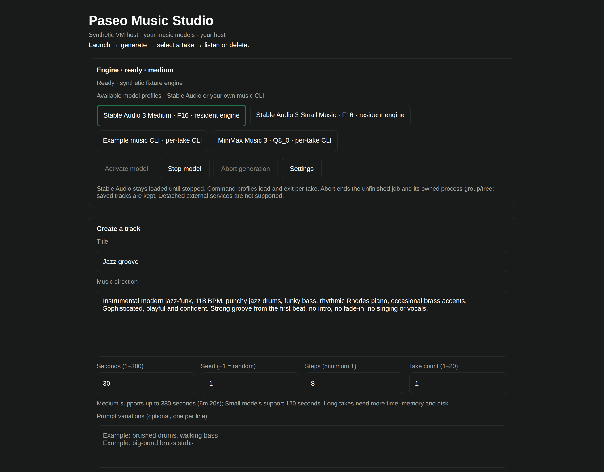
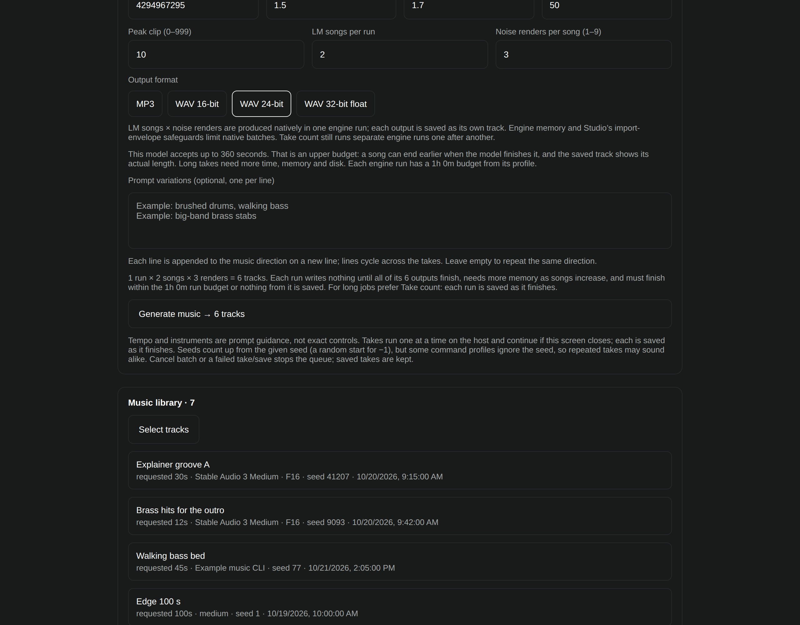
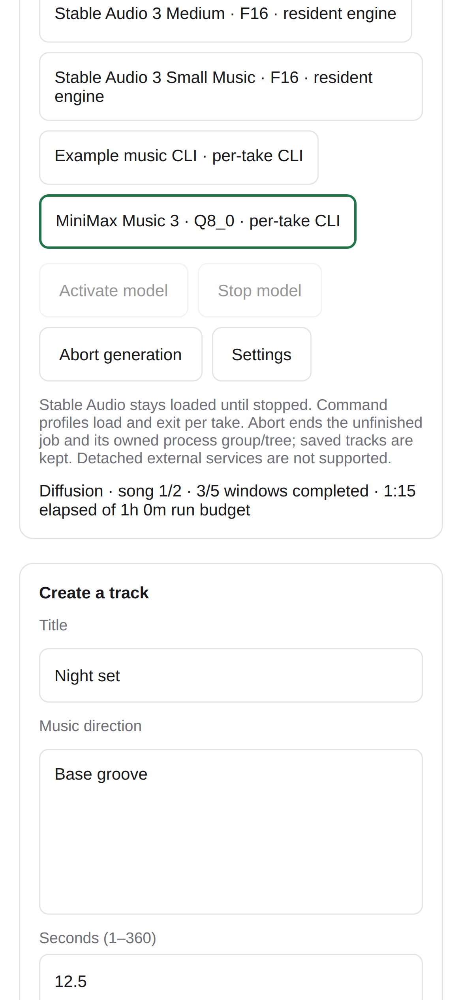

# Paseo Music Studio

A model-agnostic music studio for [Paseo](https://paseo.sh): generate, replay and manage music
with your own backends. Run the engine on your Paseo host and use the studio from your connected device.

Bring a local **MiniMax Music 3 Q8_0** installation, use **Stable Audio F16**, or connect a trusted
WAV-producing CLI. Studio does not bundle or automatically download engines, model weights or accounts.
“Model-agnostic” describes the integration boundary—not automatic support for arbitrary checkpoints.

> **Experimental · 0.5.1.** Focused native Linux checks and phone/desktop component fixtures pass.
> GPU-quality, physical-phone, relay and current cross-platform acceptance remain limited.
> See the [testing matrix](docs/TESTING.md) for exactly what was checked.



*The real Studio component with synthetic data, captured in a disposable native Linux VM.
This is not a physical-device or AI music-quality demonstration. [Screenshot provenance](docs/SCREENSHOTS.md).*

## What you can do

- **Compose or re-render:** prompts, instrumental guidance or lyrics, duration budgets, seeds and editable steps.
- **Use MiniMax's native controls:** independent song/noise seeds, a 30-step starting point, guidance,
  top-k, peak normalization, MP3 bitrate, and original MP3 / WAV16 / WAV24 / WAV32 float output.
- **Replay saved songs:** load settings and song codes without starting a job; clear replay mode to compose anew.
- **Generate batches:** up to 20 sequential runs with cycling prompt variations, plus MiniMax native songs × renders.
- **See honest progress:** engine stages and completed windows, elapsed time and the run budget—not a guessed overall percentage.
- **Keep the originals:** byte-exact playback loading, individual downloads, up to 20 tracks per ZIP,
  measured audio length for new saves, and confirmed moves to recoverable trash.

No mixing, stem separation, MIDI export or training. Prompt guidance is not a guarantee of tempo,
instrumentation, vocals or reproducibility.

## Choose a backend

| Backend | What Studio provides | What you supply |
| --- | --- | --- |
| MiniMax Music 3 Q8_0 | Native options, lyrics, replay, multi-output batches and MP3/WAV import | A compatible `mm-synth`, its five-file model set, and the [MiniMax profile](docs/BACKENDS.md#minimax-music-3-local-q8_0) |
| Stable Audio | Resident [sa3.cpp](https://github.com/betweentwomidnights/sa3.cpp) integration; Medium, Small Music and Small SFX | Compatible `sa3-server` and the [supported F16 files](docs/USAGE.md#stable-audio-model-files); conditioners use F32 |
| Your own CLI | Shell-free arguments, cancellation, validated WAV import and the shared library | A trusted generator or wrapper meeting the [backend contract](docs/BACKENDS.md) |

Generation runs on the **daemon host**, not your phone. Hardware and model licensing depend on your
chosen backend; there is no validated universal RAM/VRAM minimum.

## Install from a checkout

Requires **Paseo 0.12.x or 0.13.x on daemon and app** (manifest: `>=0.12.0 <0.14.0`),
Node.js and npm for source setup, and a separately installed backend. Checks used Node.js 22.22.1.

Review the code first: Paseo plug-ins are trusted, unsandboxed software with the daemon user's
filesystem, process and network permissions. Dependencies come from your configured npm registry;
these commands do not install a music engine or weights.

From your cloned or extracted checkout on the **daemon host**:

```bash
npm ci --ignore-scripts
npm run typecheck
paseo plugin install "$PWD"
paseo plugin ls
```

Paseo's global **Settings → Plugins → Enable plugins** switch must already be enabled by you;
this guide does not change it. Check that `paseo plugin ls` reports `running`, then open
**Paseo Music Studio** from the sidebar or **Open Paseo Music Studio** from Command Center.
See [Paseo's installation guide](https://paseo.sh/docs/plugins) if the entry is missing.

No public repository URL, npm package availability or registry listing is claimed here.
[Release preparation](RELEASING.md) describes the proposed identity and approval gates.
The installation's stable runtime ID is `paseo-music`.

## Make your first track

1. Open Studio **Settings** and set a dedicated, writable **absolute music output folder**.
2. Configure either Stable Audio's executable/model paths or a reviewed
   [custom command profile](docs/BACKENDS.md). Leave Stable Audio paths blank for command-only use.
3. Select the profile and **Activate model**. For command profiles, Ready means the executable is
   available; the model loads during generation. Stop the current model before switching.
4. Enter a title and music direction. Choose the requested seconds, seed and steps. For MiniMax,
   choose Instrumental or Sung lyrics; Advanced exposes native options. Defaults remain editable.
5. Press **Generate music**. For long jobs, prefer sequential Take count over a large native batch:
   native outputs are written only after that run finishes rendering, within its configured timeout.
6. Select a saved track to listen, download or reuse its MiniMax settings and song codes.
   Reuse only fills the form; generating still requires an explicit press.

For example:

> Instrumental modern jazz-funk, 118 BPM, punchy drums, funky bass, rhythmic Rhodes piano,
> occasional brass accents. Strong groove from the first beat, no intro, no singing.

MiniMax accepts fractional seconds up to its normal 360-second budget; songs may end earlier.
Stable Audio Medium allows up to 380 seconds and Small models up to 120.
The [usage guide](docs/USAGE.md) covers batches, replay, cancellation, recovery and troubleshooting.

## Listen, download and keep control

Playback uses your existing Paseo connection. Audio loads completely before playing; it is not live
streaming. Long files arrive in chunks without transcoding and still need device memory.
Use Paseo's voice playback control to interrupt audio—**Stop model does not stop playback**.

Browser downloads need a separately reachable private route:

- **Trusted same Wi-Fi/LAN:** no extra app, but **unencrypted HTTP**. Confirm trust each time;
  avoid public/guest Wi-Fi. Anyone with the link and network access can fetch the audio.
- **Optional Tailscale:** encrypted private networking from Tailscale Inc., configured on both
  devices. Studio does not install it. See [setup, privacy and removal](docs/USAGE.md#download-to-a-phone-or-computer).

Deleting moves tracks to `.trash`; it does not erase them or free disk space. If saving fails,
use **Retry save before reloading or disabling** the plug-in. [Recovery details](docs/USAGE.md#delete-restore-and-recover).

## More views

| MiniMax controls | Phone generation progress |
| --- | --- |
|  |  |

These use synthetic fixtures in a Linux VM, not real user prompts or music.
See [all screenshots and their scope](docs/SCREENSHOTS.md).

## Documentation and contributing

- [Usage and troubleshooting](docs/USAGE.md) · [Backend profiles and contract](docs/BACKENDS.md)
- [Testing and platform matrix](docs/TESTING.md) · [Contributing](CONTRIBUTING.md)
- [Security boundaries](SECURITY.md) · [Changes](CHANGELOG.md) · [Release preparation](RELEASING.md)

For reports, include versions, OS/architecture and redacted reproduction steps. Do not post private
prompts, music, host paths or live download links without consent.
To remove Studio, recover pending saves first and follow [uninstall](docs/USAGE.md#uninstall).

## License

Studio's code is [MIT licensed](LICENSE). Engines, model weights and dependencies have separate
terms; see [third-party notices](THIRD_PARTY_NOTICES.md). Weights are not bundled.
This license does not grant rights to generated music or guarantee it is unique or cleared for use.
